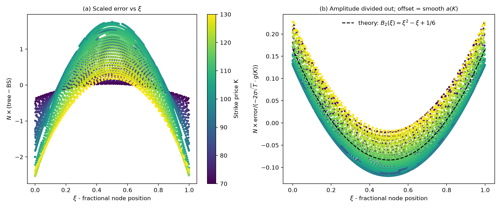

# Odd-Even-Convergence-Error-Numerical-Analysis
A numerical investigation and statistical analysis of the Odd/Even effect in the Cox-Ross-Rubinstein binomial tree as compared against the closed form Black Scholes Model. 



Error convergence in a Cox-Ross-Rubinstein binomial tree is not smooth and involves oscillations up and down depending on whether N is an odd or even number. My goal with this investigation is to show that these oscillations can be mapped predictably onto a function of where the strike sits among the terminal nodes. Furthermore, this script aims to show that a method of correction through which the error can be reduced is through subtracting a predicted oscillating term at no extra computational cost.

# Headline results
All results are for a European call with:
Initial stock price ($$S0$$) = 100
Time in years ($$T$$) = 1
Risk-free rate ($$r$$) = 5%
Volatility ($$sigma$$) = 20%
Variable strike price ($$K$$) = 70 to 130
Variable number of steps ($$N$$) = 1000 - 1999

- The oscillation is a quadratic in the fractional node position (xi) of the strike’s node at maturity (t = T), with the equation: $$N \times (\text{tree} - \text{BS}) = a(K) + b(K) \times B_2(\xi) \qquad$$ where $$B_2(\xi) = (\xi)^2 - \xi + 1/6$$ and $$B2(x)$$ is the second Bernoulli equation. Iterating through 60 strike prices (excluding $$ K = S0 $$ ) and applying linear least squares regression produced a coefficient of determination ( $$ R^2 #$$ ) > 0.9989 with median 0.9999

- The amplitude matches a formula from a heuristic argument. The fitted $$b(K)$$ equals $$-2\sigma \times \sqrt{T} \times g(K)$$ where $$g(K) = K \exp{-r \times T} \phi(d_2)$$, to within 0.1%. (b/g ratio between -0.4003 and -0.3998 and theoretical ratio equal to -0.4)

- Subtracting the predicted term lowers the error at no extra computational cost. This led to median absolute error to shrink 2.25x and the maximum absolute error to shrink 3.59x (table below)

# Background
A call option is a derivative contract that derives its value from the performance of an underlying asset. For a premium (upfront price) to be determined, a call option gives the buyer the right, but not the obligation to buy the asset at a predetermined price (the strike price) on or before a the expiration date. The Black Scholes model is a financial model used to estimate the theoretical exact value of financial options. For the purpose of benchmarking the Cox-Ross-Rubinstein against the closed form Black Scholes, this investigation will focus on European Call Options, which allow the buyer to sell only on the expiration date. 

Options pricing through a Cox-Ross-Rubinstein binomial tree involves partitioning the option lifetime into discrete steps $$dt = T/N$$ (where $$T$$ is time at maturity and N is the total number of steps). After each time step, the stock price can either go up or go down an equivalent amounts. At the expiration date, the final price of the stock will be the expected payoff of the option if it were to be exercised by the buyer. The premium to buy this call option follows the formula:
$$C = discounted expected payoff under risk-neutral probabilities$$ 

It is intuitive to conclude that increasing N (therefore reducing the size of each time increment) constitutes a smooth and consistent convergence of the price to that modelled by the Black-Scholes model. However, this does not happen due to the odd/even effect, where the error between option price computed by the tree and that of Black-Scholes does not shrink smoothly as N grows, but instead alternates depending on whether N is odd or even.
  
# Methodology
**Models:** A Cox-Ross_Rubinstein binomial tree where the up factor ($$u = exp{sigma \sqrt{T}}) and down factor ($$d = 1/u$$) allow the tree to recombine. The model is implemented in the script to adopt two different methods of computing the option price. First is backward induction through the tree, second is a faster equivalent that sums the terminal payoff weighted by the binomial probabilities of $$j$$ number of up movements that occurred during the lifetime of the option. Validation check within the script returned a difference of 2.1e-12 between the two pricing methods across 9 test cases (K = 70, 100, 130; N = 101, 500, 1000). In every practical sense, they agree completely. The script moves forward with the fast version. The Black-Scholes model is used to compute the exact option price that will be compared against in subsequent tests. 

**Fractional Node Position (ξ):** The terminal nodes at maturity ($$t = T$$) on the binomial tree give a stock price of $$S0 exp{(2j - N) \sigma \sqrt{dt}}$$. Taking the strike price to be equal to S0 and solving for the node index of the terminal node, the formula $$j* = 1/2 \times [N + ln(K/S0)/(\sigma \sqrt{dt})]$$, where the fractional part of j* is represented by ξ (when ξ is 0, the node lands exactly on strike price K, otherwise it lies just above or under it). Because ξ depends on $$N$$, using every integer $$N$$ makes ξ sweep through [0, 1).

**Error Measure:** Error is scaled by $$N$$ to produce $$scaled error = N \times (tree - BS)$$, where tree and BS represent the option price computed by the binomial tree and Black Scholes models respectively. Scaling by $$N$$ removes the $$1/N$$ shrinkage so values at different $$N$$ can be compared. Scaled error is signed because the binomial tree price oscillates between being larger and being smaller than the Black Scholes price as ξ varies. 

**Hypothesis H1:** Scaled error depends on ξ. This will be validated by computing individual values of scaled error and ξ for every $$N$$ at each strike price, producing a total of 61000 entries of data. A scatter plot will be produced to demonstrate the dependency.

**Hypothesis H2:** For each strike, $$N \times (tree - BS) = a(K) + B(K) \times B_2(ξ)$$, with $$b(K) = -2\sigma \sqrt{T} \times K \exp{-r \times T} \phi(d_2)$$. $$-2\sigma \sqrt{T}$$ is derived from a heuristic Euler-Maclaurin argument:


**Correction:** Corrected price = tree price - $$b(K) \times B_2(ξ)/N$$. This does not depend on any fitted numbers. 

# Results
**1. Error against ξ:** Across all 61000 data points, scaled error remains in the range between 
In the special case where strike price equals S0, ξ = 0 for even N and ξ = 0.5 for odd N. Scaled error is -1.9995 for even $$N$$ and +1.7528 for odd $$N$$: these are two points of the same curve

**2. Quadratic fit:**
K = S0 excluded due to ξ only being able to take 2 values

| | Result |
|---|---|
| Strikes fitted | 60 (K = 70 to 130, K = S0 excluded) |
| R², min / median | 0.9989 / 0.9999 |
| b/g, min / median / max | −0.4003 / −0.4000 / −0.3998 |
| Theory (−2σ√T) | −0.4000 |

**3. Effectiveness of the correction method:**

| Absolute error against Black Scholes | Median | 95th percentile | Max |
|---|---|---|---|
| Plain tree | 4.35e-04 | 1.35e-03 | 2.44e-03 |
| Corrected | 1.93e-04 | 4.41e-04 | 6.80e-04 |
| Improvement | 2.25× | 3.06× | 3.59× |

# Limitations of the Script
- Hypothesis two (H2) and the coefficient $$-2\sigma \sqrt{T}$$ were validated on the same parameter set ($$S0 = 100, T = 1, r = 5%, \sigma = 20%$$). There is no out-of-sample test with other combinations of the same parameters, will strengthen the validation.
- Heuristic derivation. The amplitude formula comes from a non-rigorous argument and matches the data to about 0.1% on this one parameter set.
- The smooth term a(K) is not explained. It is visible as the vertical offset in panel (b) and limits the correction to a 2–4× improvement.
- This only investigates European call options and no focus on American options. The range of values for $$N$$ are limited to between 1000 and 1999. 
- The correction is not a practical pricer for European options. It uses the Black-Scholes density at the strike, so it validates the theory; a European call already has an exact formula.

# Reproducing the Results
```
pip install numpy scipy pandas matplotlib
python OEandStrikePrice.py
```

This outputs two .csv files and one .png file:
- OE_relation_results.csv (61,000 rows of data entries for $$K$$, $$N$$, ξ and scaled error)
- OE_fit_results.csv (each row of data entries for $$a$$, $$b$$, $$b/g$$ ratio and $$R^2$$ (coefficient of determination) corresponds to one particular striike price $$K$$)
- OE_figure.png features the scaled error against ξ scatter plot and the quadratic fit scatter plot

# AI-assistant declaration
This script is assisted by AI for hypothesis suggestions and help in the form of debugging and code review. All forms of code relating to price, fitting and corrections are implemented and their results are validated by me.

